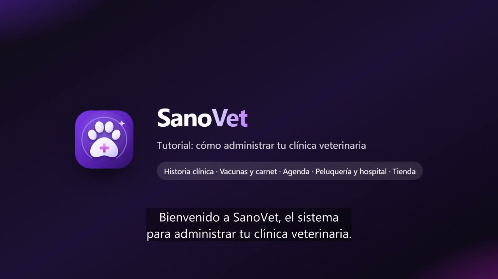

# SanoVet 🐾

Software de gestión para clínicas veterinarias de la línea **Sano** (SanoGym, SanoDental, SanoDoctor, SanoTecnico, SanoGestion, SanoCortes, SanoFarmacia).
PWA instalable (PC, tablet, Android, iPhone) y mundial: el país se elige la primera vez y define moneda,
formas de pago y código de WhatsApp. Opcionalmente trabaja con una segunda moneda (por ejemplo dólares y bolívares).

**Producción:** https://sano-vet.web.app · **Credenciales:** `CREDENCIALES_SANO_VET.txt` (no se sube a git)



## Qué hace

| Módulo | Detalle |
|---|---|
| Mascotas | Ficha de cada paciente con foto, especie (perro, gato, ave, conejo, roedor, reptil), raza, sexo, edad, peso con su curva, microchip, esterilización, alergias, condiciones, temperamento y alimentación. Un tutor puede tener varias mascotas. Importar/exportar CSV. |
| Historia clínica | Consulta, control, vacunación, emergencia, cirugía o domicilio con motivo, anamnesis, **signos vitales con alerta por especie** (temperatura, frecuencia cardíaca y respiratoria, TLLC, condición corporal), examen, diagnóstico, plan y **récipe** (impreso o por WhatsApp). “Guardar y cobrar” pasa la consulta a la caja. |
| Vacunas y desparasitación | Catálogo de vacunas configurable con su refuerzo; desparasitación interna y externa. Calcula la próxima dosis, marca las vencidas y descuenta la dosis del inventario con su lote. |
| Carnet digital | `/carnet/CÓDIGO` con QR: vacunas, desparasitación, alergias y próximo control en el teléfono del tutor, con botón para agendar por WhatsApp. |
| Agenda | Semana por veterinario o peluquero, espacios libres, aviso de choque de horario, confirmación por WhatsApp y **sala de espera** (“Llegó” → “Atender”). |
| Peluquería y hospital | Peluquería en columnas (recibido, en baño, secado y corte, listo) con aviso al tutor; hospitalización con estado (internado, observación, crítico, alta) y bitácora de evolución; ambos se cobran al entregar. |
| Recordatorios | Vacunas, desparasitaciones y controles por tocar o vencidos, cumpleaños, saldos, planes y puntos, cada uno con su WhatsApp listo. |
| Tienda | Alimento por saco o por kilo, medicamentos por caja, blíster o unidad, lotes y vencimientos (sale primero lo que vence antes), servicios, planes y seguros (descuento o cobertura), crédito, puntos y varias formas de pago. |
| Pedidos en línea | Catálogo público `/pedido/NOMBRE` (sin servicios): el tutor pide alimento, antiparasitarios y accesorios con delivery o para retirar, sin cuenta. |
| Compras, caja y reportes | Sugerido de compra, órdenes por WhatsApp, recepción con lote y costo promedio, cuentas por pagar, caja con cierre, facturas con anulación por PIN y reportes de ventas, servicios, ganancia, ABC, horas pico e inventario. |
| Demo | 30 minutos sin registro con una clínica completa de ejemplo (PIN 1234) y recorrido guiado; todo se borra al terminar. |

## Estructura

- `public/` — la app (JavaScript sin compilación + Firebase 10.14.1). `js/views/` una pantalla por archivo; `js/ops.js` reglas de negocio (mascotas, vacunas, consultas, citas, peluquería y hospital, ventas, lotes, compras, pedidos); `js/vet.js` especies, vacunas, signos vitales, servicios, presentaciones y lotes FEFO; `js/client.js` ficha de la mascota y del tutor; `js/store.js` datos en tiempo real.
- `firestore.rules` — cada clínica solo ve lo suyo (`tenants/{uid}`); `cards/{código}` y `shops/{nombre}` se leen solo por clave exacta; `orders` valida cada pedido en línea.
- `scripts/` — aprovisionamiento, pruebas y video tutorial.

## Comandos (desde `scripts/`)

```sh
# Emuladores (en la carpeta del proyecto)
firebase emulators:start --project sano-vet   # app en http://127.0.0.1:5131/?emu=1

sh test-emu.sh                 # crea 3 cuentas en el emulador y corre la prueba E2E (50 verificaciones)
node mobile-check.mjs          # sin scroll lateral de 320 px a 1366 px
node prod-smoke.mjs            # prueba rápida en producción (la demo se limpia sola)
node pwa-check.mjs             # instalable en PC y Android

node provision.mjs 20          # crea/actualiza las cuentas en producción
node icons.mjs                 # regenera íconos y logos desde public/assets/logo.svg
node tutorial/make-video.mjs   # graba el video tutorial narrado (voz es-VE)
firebase deploy --only firestore,hosting,auth --project sano-vet
```
